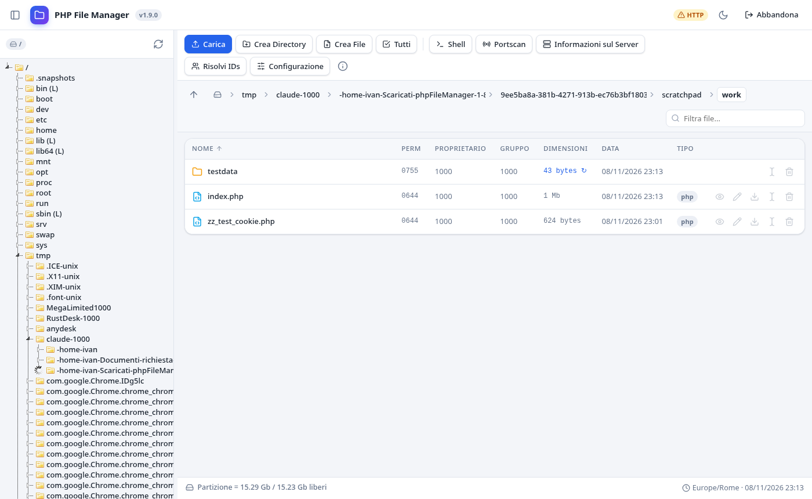
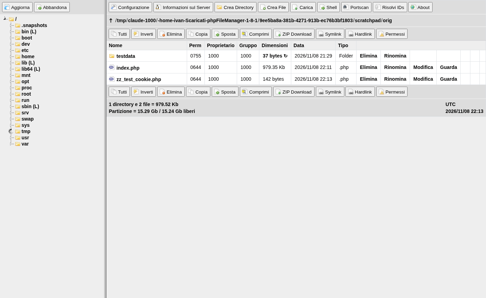

# phpFileManager 1.9.0 — hardened fork

> **This is an improved fork, not the official release.**
> phpFileManager is a project by **Fabricio Seger Kolling** ([dulldusk/phpfm](https://github.com/dulldusk/phpfm), [SourceForge](https://sourceforge.net/projects/phpfm)), developed since 2004.
> This fork, maintained by **Ivan Bertotto**, starts from the official 1.8.1 release and adds a complete security review and a redesigned interface. The project's philosophy is unchanged: **one PHP file, no dependencies, no installation**.

phpFileManager is a complete filesystem management tool in a single file: directory tree, multiple upload, code editor with syntax highlighting, zip/tar/gzip/bzip2, symlinks and hardlinks, chmod, a shell terminal emulator, ping/port scan, server info and 20 languages. Images, JavaScript and CSS are embedded in the file itself, so it also runs on offline devices such as a Raspberry Pi.

The original is a great piece of work. But a tool that, by design, can read, write and execute anything on the server needs defences that match today's web, and the 2004-era code was missing several of them. This fork closes those gaps and modernises the UI, while staying a drop-in replacement for 1.8.x.

- **Italian article** describing the work and the use cases (especially in schools): <https://www.ivanbertotto.it/s/blog/phpfilemanager-1-9-0-piu-sicuro-piu-moderno>
- **Full security review**: [SECURITY-REVIEW.md](SECURITY-REVIEW.md)
- **Changes**: [CHANGELOG.md](CHANGELOG.md)

## What changed compared to 1.8.1

### Security

| Area | 1.8.1 | 1.9.0 (this fork) |
|---|---|---|
| Password storage | unsalted MD5 | bcrypt (`password_hash`); old MD5 passwords are migrated automatically at first login |
| Session cookie | contained the MD5 hash itself (stolen cookie = permanent login) | HMAC token with a per-install secret, `HttpOnly`, `SameSite=Strict`, `Secure` on HTTPS |
| Plain-text password | stored in a second cookie and printed back in the config form | never sent back to the browser |
| CSRF | no protection on any action | token required on every state-changing request (403 otherwise) |
| Brute force | unlimited attempts | 5 failures → 5 minutes lock, minimum length 8 |
| Upload filter (CVE-2026-72592 fix) | ineffective: the extension list was always read as empty, `.php` uploads passed | works, editable in the configuration |
| Root folder | not a real boundary, `../` accepted | names and paths validated and confined to the root |
| Shell commands | file names concatenated into `du`, exec, `cd`, `icacls` | every argument through `escapeshellarg` |
| XSS | several reflected/stored points | systematic escaping; inline-viewed files served with `Content-Security-Policy: sandbox` |
| Register globals | any request parameter became a global variable | only scalar values, blocklist for config/auth variables |
| External requests | "About" loaded an iframe from a third-party domain | local panel, no external calls |
| Headers | none | `X-Frame-Options`, `nosniff`, `Referrer-Policy`, `frame-ancestors` |
| jQuery | 1.11.1 (2014, known CVEs) | 3.7.1 |
| Config save | in-place, a failed write could truncate the file | atomic (temporary file + rename) |

PHP 8 fatal errors and dozens of notices were fixed as well: with `error_reporting(E_ALL)` the file emits no warnings.

### Interface

Application layout instead of the old `<frameset>` look, resizable/collapsible sidebar, clickable breadcrumb, **light and dark theme** following the OS preference (editor and terminal included), vector icons ([Lucide](https://lucide.dev), ISC license), file list with sticky header, instant filter and per-row actions, contextual selection toolbar, drag & drop upload with progress bar, modal windows, tabbed configuration with full timezone list, responsive layout. New strings are translated into English and Italian (other languages fall back to English).

| Before (1.8.1) | After (1.9.0) |
|---|---|
|  |  |

More screenshots in [`screenshots/`](screenshots/): [dark theme](screenshots/03-dark-theme.png), [login](screenshots/01-login.png), [configuration](screenshots/04-configuration.png), [upload](screenshots/05-upload.png), [permissions](screenshots/06-permissions.png), [port scan](screenshots/07-portscan.png), [about](screenshots/08-about.png), [editor](screenshots/09-editor.png), [shell](screenshots/10-shell.png).

## Requirements

- PHP 7.3 or later (tested on PHP 8.4 and 8.5)
- `mbstring` extension
- The folder containing the script must be **writable by the web server**: password and configuration are stored inside the script itself (line 2), exactly like the original.

## Installation

### Option A — guided installer

[`installer/phpfm-installer.php`](installer/phpfm-installer.php) is a single file that does everything for you:

1. Upload `phpfm-installer.php` to the folder where you want the file manager.
2. Open it in the browser **within one hour** (after that it refuses to run, so a forgotten installer cannot be abused).
3. Choose a file name (a random one is suggested), the password, the root folder, language and timezone.
4. The installer downloads `index.php` from this repository (tag `v1.9.0`, with a mirror on ivanbertotto.it), **verifies its SHA-256 fingerprint**, writes the configuration with the bcrypt hash and then **deletes itself**.

On servers without Internet access, upload `index.php` renamed as `phpfilemanager-1-9-0-index.txt` next to the installer: it is used instead of the download, after the same fingerprint check.

The installer UI is in English, or Italian when the browser prefers Italian.

### Option B — manual

1. Copy `index.php` to a folder of your server. Renaming it to something hard to guess is a good idea.
2. Open it in the browser: on first access you are asked to create a password (at least 8 characters).
3. In the configuration, set the root folder you want to expose and, optionally, language, theme and timezone.

### Upgrading from 1.8.x

Replace the file content but **keep line 2** (the `//{...}` JSON configuration line): the format is unchanged and two keys are added (`fm_pass_hash`, `fm_secret`). The old MD5 password keeps working and is converted to bcrypt at the first login. Note that "no password = open access" no longer exists: without a password the manager only shows the "create password" form.

## Security notes

This is, by nature, an authorised web shell: whoever logs in can read and write any file reachable by the web server and run commands. The review focused on everything that would let an **unauthenticated user** or a **third-party site** reach those functions, and on what would make the administrator's session stealable. Still:

- publish it only over **HTTPS**, ideally behind a VPN or an IP allowlist (e.g. `.htaccess`), with an unpredictable file name;
- set the root folder to limit what can be browsed;
- remove it from the server when you no longer need it.

Known residual risks (symlinks pointing outside the root are still followed, lockout keyed on `REMOTE_ADDR`, no server-side idle timeout, Windows branches reviewed but not tested) are listed in [SECURITY-REVIEW.md](SECURITY-REVIEW.md#4-residual-risks-and-advice).

## Credits and license

- Original author: **Fabricio Seger Kolling** — <https://github.com/dulldusk/phpfm>. The original header of `index.php` is kept intact, as the author requests.
- Fork, security review and new interface: **Ivan Bertotto** — <https://www.ivanbertotto.it>
- Icons: [Lucide](https://lucide.dev) (ISC). Bundled libraries: jQuery 3.7.1 (MIT), jsTree 3.3.7 (MIT), jquery.terminal 2.2.0 (MIT), Ace 1.4.2 (BSD).

Same licenses as the original, at your choice: **GPL 2.0 or later**, **LGPL 2.1 or later** or **MPL 1.1 or later** (see [LICENSE](LICENSE)).
The fixes are offered back to the original project: anyone, including the upstream author, is welcome to merge them.

THE PROGRAM IS PROVIDED "AS IS", WITHOUT WARRANTY OF ANY KIND. See the license for details.
